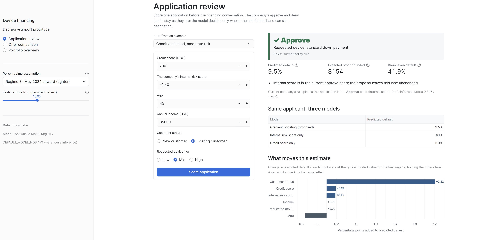
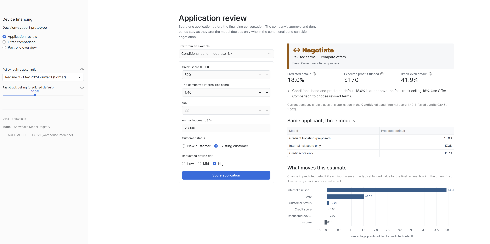
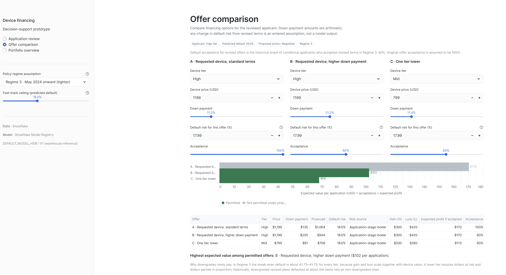
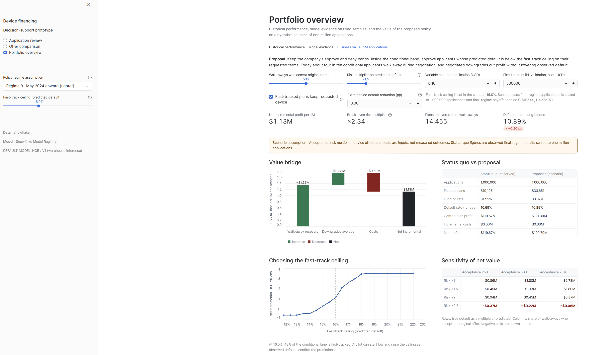

# Device Financing Decision Dashboard

A decision-support prototype, built with Streamlit in Snowflake, for an in-store device financing program. It puts three default-risk models into the workflow of the people who make and oversee financing decisions: sales reps reviewing one application, and managers weighing the impact of a policy change.

> Simulated data from an academic case study. No real customer data is used, and the business practices described are hypothetical.

## The question

The company finances devices much like an auto loan: a down payment, then monthly installments. A proprietary internal risk score sorts each in-store application into **Approve**, **Deny**, or **Conditional**. Conditional applicants get a counteroffer, such as a cheaper device or a larger down payment, and about four in ten walk away, many of whom would have repaid.

**Can a default model safely fast-track the lower-risk part of the Conditional lane, and what is that worth?**

## Results

| Metric | Value |
|:---|:---|
| Net incremental profit per 1M applications, default settings | **+$1.13M** on a $119.67M baseline |
| Same, with the fast-track ceiling at 18% | **+$3.43M** |
| Break-even risk multiplier (where the gain reaches zero) | about ×2.3 |
| Conditional applicants lost in negotiation (Regime 3) | 39.7% |
| Holdout log loss: HGB / internal / credit | 0.2723 / 0.2754 / 0.2774 |
| Out-of-time log loss (Oct–Dec 2024): HGB / internal / credit | 0.3344 / 0.3386 / 0.3423 |
| Existing-customer default in Regime 3: actual / internal / HGB | 11.9% / 8.2% / 11.1% |

Default settings: a fast-track ceiling of 16%, 50% of walk-aways accepting the original offer, and fast-tracked applicants defaulting at 1.5× the model's prediction. All values are read from the Snowflake evidence tables.

## The dashboard

| Application review | Offer comparison | Portfolio overview |
|:---:|:---:|:---:|
|  |  |  |
| **Sales rep.** Score one application and see the recommended lane. | **Sales rep.** Compare the original offer with a modified one. | **Managers.** Historical KPIs, model evidence, and a value estimate for 1M applications. |

## Decision rules

The proposal changes as little as possible, so it stays easy to explain, pilot, and roll back.

1. **Approve and Deny are unchanged.** They remain two thresholds on the internal score: 0.845 and 1.502 in the latest regime, inferred from historical data.
2. **The model acts only inside the Conditional lane.** A predicted default below the fast-track ceiling (16% by default) means approval on the original terms. Everyone else negotiates as before.
3. **Out-of-range cases go to a supervisor.** That covers invalid inputs, and an internal or credit score outside the range previously financed in that regime, where the model would be extrapolating.
4. **No causal claim about down payments.** A modified offer keeps the application-stage prediction, and any manually entered risk is labeled "Entered scenario risk."

## How it's built

- **Data.** 300,000 simulated applications from January 2023 to December 2024 with 18 fields each, 265,060 of them funded. The risk policy changed twice, so the analysis uses three regimes and takes its thresholds from the latest.
- **Models.** Credit-only and internal-only baselines (cubic spline + logistic regression) against a scikit-learn `HistGradientBoostingClassifier` that combines both scores with age, income, customer status, requested device tier, and policy regime. All are trained on funded applications, the only ones with an observed default. Self-reported demographics are never inputs; they are used only for the subgroup audit.
- **Validation.** Log loss, since the decision needs well-calibrated probabilities, on a stratified 75/25 holdout and on an out-of-time test (October–December 2024).
- **Pipeline.** `model/train_register.py` trains, evaluates, writes the evidence tables, and registers the models. The dashboard reads every figure from those tables, and falls back to a joblib artifact on a stage if the Model Registry is unavailable.

**Stack:** Snowflake (warehouse, stages, Model Registry), Streamlit in Snowflake, Python, scikit-learn, pandas, Altair, Snowflake CLI.

<b>Data dictionary (18 fields)</b>

| Column | Type | Description |
|:---|:---|:---|
| `application_date` | Date | Date the application reached its final status |
| `race`, `hisp`, `gender` | Character | Self-reported demographics (including "PreferNot"), collected only for fairness evaluation |
| `age` | Integer | Applicant age in years (18–79) |
| `income` | Integer | Annual income in USD (15,000–200,000) |
| `credit_score` | Integer | FICO credit score (327–850) |
| `existing_customer` | Integer | 1 if the applicant is already a customer of the company, otherwise 0 |
| `device_requested` | Character | Tier (Low, Mid, High) of the device first requested |
| `device_final` | Character | Tier of the device actually sold, which may differ after negotiation |
| `device_price` | Float | Cost of the final device in USD (379–1,219) |
| `down_payment_base` | Float | Down payment first suggested by the company's business rules, as a fraction of device cost |
| `down_payment_final` | Float | Down payment on the final device after any negotiation |
| `internal_risk_score` | Float | The company's proprietary risk score, normalized to zero mean; its formula is not disclosed |
| `initial_decision` | Character | Initial outcome: Approve, Conditional, or Deny |
| `final_status` | Character | Funded_Original, Funded_Revised (successfully negotiated), or Not_Funded |
| `default_flag` | Integer | 1 if the customer stopped paying before the device was paid off |
| `profit` | Float | Estimated profit or loss on the plan in USD (−426.65 to 304.75) |

## Repository

| Path | Contents |
|:---|:---|
| [`sql/`](sql/) | Setup and data load, manual app deployment, proposed pilot monitoring |
| [`model/train_register.py`](model/train_register.py) | Train → evaluate → write evidence tables → register models |
| [`app/`](app/) | Everything uploaded to Snowflake: the three pages (`streamlit_app.py`), decision rules and profit formulas (`finance_rules.py`), model loading (`scoring.py`), data access (`data_layer.py`) |
| [`screenshots/`](screenshots/) | All eight dashboard screenshots |

## Run it

You need a Snowflake account and the case-study dataset, `financing_data.csv`, which is not included in this repository.

<b>Deploying to Snowflake (about 30 minutes)</b>

1. **Load the data.** Run `sql/01_setup_and_load.sql` in a Snowsight worksheet, uploading `financing_data.csv` to `RAW_STAGE` before the `COPY INTO`. The reconciliation query should return 300,000 / 265,060 / 34,940.
2. **Train and register the models.** Paste `model/train_register.py` into a Snowsight Notebook on `DASHBOARD_WH`, with `scikit-learn`, `snowflake-ml-python`, `pandas`, and `joblib` added under Packages. It writes 8 evidence tables, registers 3 models in the Model Registry, and saves a backup to `@MODEL_STAGE/default_models.joblib`. To retrain, change `MODEL_VERSION` to V2 first.
3. **Match the scikit-learn version.** Put the result of `SELECT DISTINCT SKLEARN_VERSION FROM MODEL_INFO;` on the `scikit-learn=` line of `app/environment.yml`. A mismatch is the most common failure: the backup model will not load.
4. **Deploy the app.** Run `cd app && snow streamlit deploy --replace`, or follow `sql/02_deploy_streamlit.sql` to deploy by hand.
5. **Confirm the model source.** The bottom of the sidebar should read `Model · Snowflake Model Registry`. If it reads `Snowflake stage artifact`, the Registry call failed and the app is running on the backup: check Registry permissions and that `snowflake-ml-python` is listed in `environment.yml`.

